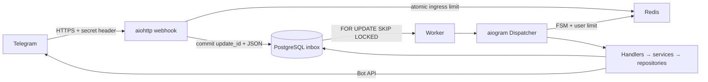

# Architecture and extension points

The receiver validates request size, content type, secret, and Telegram update shape. Its transaction
inserts a durable row with `update_id` as a primary key. It sends HTTP 200 after commit, including
on duplicate deliveries. Redis is used for shared rate limits and FSM; PostgreSQL is the queue of record.

A worker locks one ready row until dispatch finishes. Multiple workers use `SKIP LOCKED`; no lease
renewal process is needed. A crashed process releases its database transaction, making the row eligible
again. Short handlers run under a bounded timeout. Database side effects in handlers are inside a
savepoint: failures roll those changes back before the retry metadata is committed.

Keep the transaction short. Put long-running CPU work or external jobs in a separate domain-specific
queue, carrying an idempotency key. Telegram requests and Redis writes are outside PostgreSQL's atomic
boundary. A crash after sending but before committing can send twice. Redis FSM changes can also
survive a failed database transaction. Make critical business operations idempotent and use a domain
outbox when external delivery needs independent retries.

One worker handles ready updates in ID order, but delayed retries allow later updates to run first.
Multiple workers improve throughput; event isolation is mutual exclusion, not strict arrival ordering.
For strictly ordered conversations,
partition jobs by chat or introduce ordered per-chat queues. Size the database connection limit for
every app/worker replica's pool plus migration/monitoring headroom.

Dependency injection is explicit: `session`, `settings`, `rate_limiter`, and `db_user` enter handlers
through aiogram workflow data. Routers are built by factory, allowing fresh independent test apps.
Infrastructure is created at startup and closed on shutdown; imports never open connections.

Successful payloads are cleared immediately. Completed IDs provide deduplication until scheduled
cleanup. Failed records retain the original payload for operator review and explicit retry. They may
contain personal data: restrict DB roles, encrypt backups, and establish a bounded failed-data policy.

This template does not add Django WhiteNoise: it serves no browser/static assets. Use a CDN/object
store for future user files, with signed URLs and size/content validation where the domain requires it.
